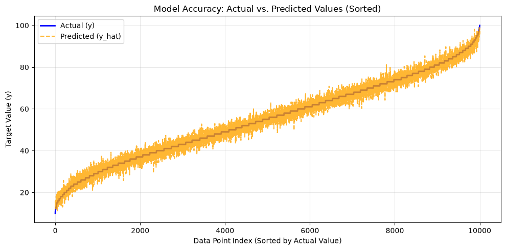

# Multiple-Linear-Regression
This project is a from-scratch implementation of a multi-variate linear regression model trained on real data from Kaggle.
The purpose of the project is to explore linear regression behind the scenes by training a model from scratch to predict an index output (0-100) of student performance based on various factors such as hours studied, previous scores, extracurricular activities, sleep hours, and sample question papers practiced. 

Kaggle dataset credits to Nikhil Narayan (nikhil7280)

## Tech Stack & Libraries
- Python
- numpy
- matplotlib

## Installation
1. Clone this repository
git clone https://github.com/eCarCodes/Multiple-Linear-Regression.git
cd Multiple-Linear-Regression

2. Install the required dependencies
python -m python -m pip install -r requirements.txt
Note: On macOS/Linux, you may need to use python3 instead of python.

3. Launch Jupyter Notebook
jupyter notebook
Then open linearRegressionModel.ipynb in your browser.

## Demo

Model trained on 1500 iterations of gradient descent: 
